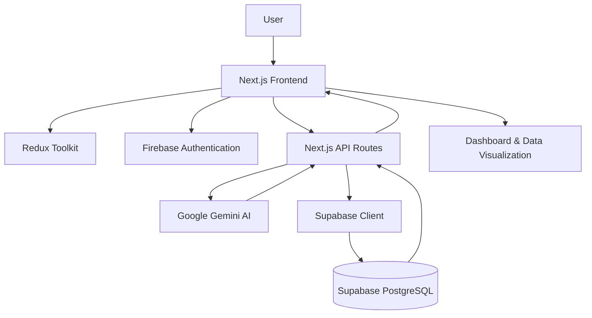
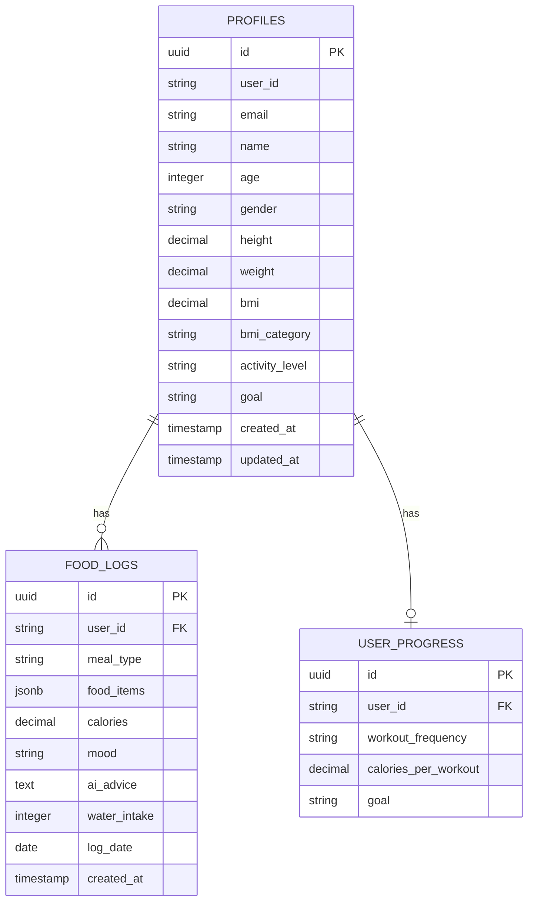
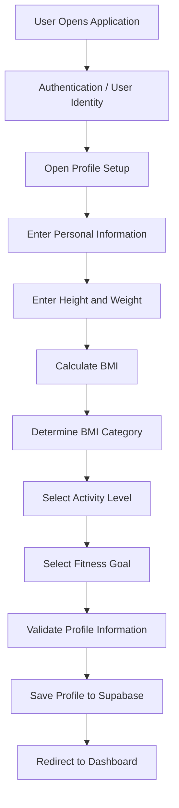
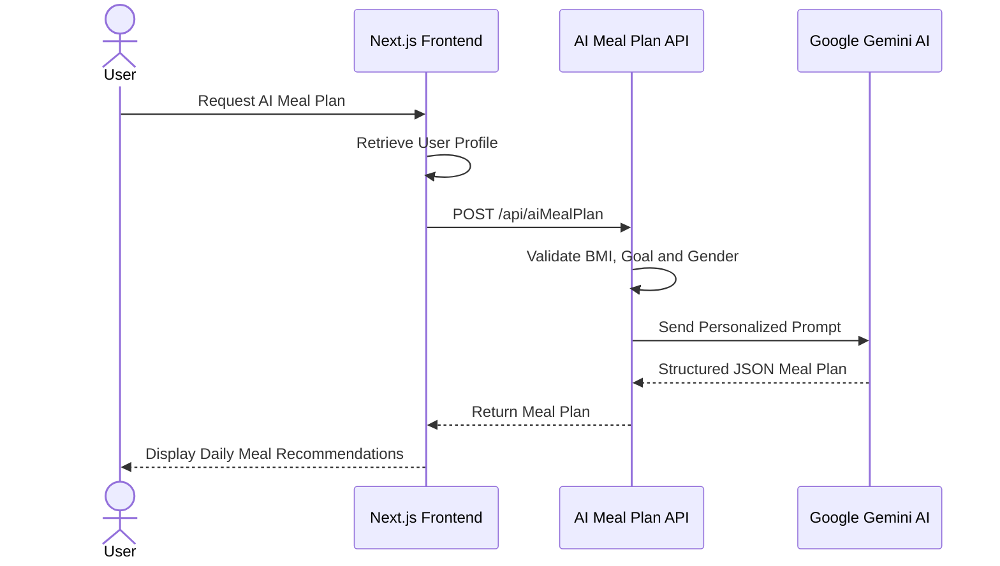
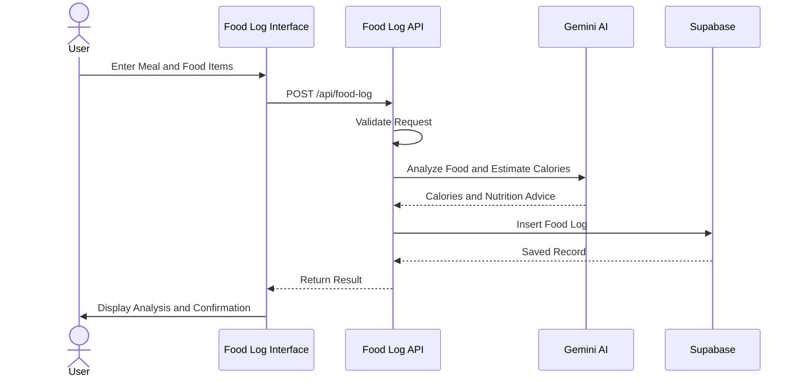
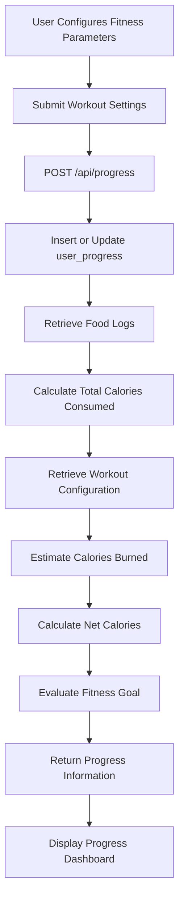

# 🥗 Smart AI Meal Planner

### AI-Powered Nutrition Tracking & Personalized Meal Planning Platform

A full-stack nutrition management application that combines AI-powered meal recommendations, calorie estimation, food logging, hydration tracking, and fitness progress monitoring.

---

## 📌 Table of Contents

1. [Project Overview](#-project-overview)
2. [Project Objectives](#-project-objectives)
3. [Major Features](#-major-features)
4. [Technology Stack](#-technology-stack)
5. [System Architecture](#-system-architecture)
6. [Application Modules](#-application-modules)
7. [Database Design](#-database-design)
8. [Entity Relationship Diagram](#-entity-relationship-diagram)
9. [Database Table Specifications](#-database-table-specifications)
10. [Application Workflows](#-application-workflows)
11. [API Documentation](#-api-documentation)
12. [AI Integration](#-ai-integration)
13. [Calorie & Progress Calculation](#-calorie--progress-calculation)
14. [Project Structure](#-project-structure)
15. [Environment Configuration](#-environment-configuration)
16. [Installation & Setup](#-installation--setup)
17. [Future Improvements](#-future-improvements)
18. [Author](#-author)

---

## 🚀 Project Overview

**Smart AI Meal Planner** is a full-stack web application designed to help individuals manage their nutrition, monitor daily calorie consumption, and maintain healthier lifestyles through AI-assisted recommendations.

The application collects personal information, including age, gender, height, weight, activity level, and fitness goals, to establish a personalized health profile.

Using Google Gemini AI, the platform generates personalized daily meal plans and nutrition recommendations based on the user's BMI, gender, and fitness objectives.

It also provides a centralized dashboard where users can record their daily meals, receive AI-generated calorie estimations, monitor hydration, and visualize their calorie consumption and expenditure.

The application follows a modular architecture using Next.js API routes for backend operations, Supabase for relational data persistence, Firebase-based user identity integration, and Redux Toolkit for frontend state management.

### Live Project

- **GitHub Repository:** https://github.com/Shafaet1074/AI-Meal-Planner
- **Application Name:** SmartMealAI
- **Project Type:** Full-Stack AI-Powered Web Application

---

## 🎯 Project Objectives

The primary objectives of this project are:

- **Personalized Nutrition Planning:** Generate customized daily meal recommendations based on individual BMI, gender, and fitness goals.
- **AI-Powered Calorie Estimation:** Analyze food descriptions and estimate their approximate calorie content using Google Gemini AI.
- **Centralized Food Tracking:** Allow users to record daily meals, food items, meal categories, and personal mood.
- **Hydration Monitoring:** Track daily water consumption and monitor hydration progress.
- **Fitness Progress Analysis:** Calculate calorie consumption, estimated calorie expenditure, and net calorie balance.
- **Data-Driven Insights:** Present nutritional and fitness information through interactive dashboards and graphical visualizations.
- **Accessible User Experience:** Provide a responsive interface with light and dark themes and intuitive navigation.

---

## ✨ Major Features

### 1. Personalized User Profile Management

Users can complete a multi-step profile setup process by providing:

- Name and age
- Gender
- Height and weight
- Physical activity level
- Primary fitness goal

The application automatically calculates:

- Body Mass Index (BMI)
- BMI classification
- Personalized fitness profile

BMI is calculated using:

\[
BMI = \frac{Weight\ (kg)}{Height\ (m)^2}
\]

The application classifies BMI into four categories:

| BMI Range | Category |
|---|---|
| Below 18.5 | Underweight |
| 18.5 – 24.9 | Normal |
| 25 – 29.9 | Overweight |
| 30 or above | Obese |

Users can revisit their profile and update their personal information.

### 2. AI-Powered Personalized Meal Planning

The application integrates Google's Gemini AI to generate personalized daily meal plans.

The AI receives the following profile information:

- BMI
- Gender
- Fitness goal

Based on these parameters, it generates a structured daily meal plan containing:

- Breakfast
- Lunch
- Snacks
- Dinner
- Nutrition summary

Each meal contains recommended food items and estimated calorie information.

The application also incorporates Bangladeshi food preferences and local ingredients, such as rice, roti, Rui fish, lentils, and seasonal fruits.

**Implementation details:**

- Next.js API route handles AI requests.
- Google Generative AI SDK communicates with Gemini.
- Structured JSON output is used to maintain a consistent response format.
- Fallback meal-plan generation is implemented for AI service failures.

### 3. AI-Generated Health Recommendations

The application generates contextual health tips using Gemini AI.

The recommendations consider:

- User BMI
- Gender
- Fitness objectives

The system generates four motivational health tips covering areas such as hydration, nutrition, physical activity, and healthy lifestyle habits.

A predefined fallback mechanism provides recommendations when AI generation fails.

### 4. Food & Meal Logging System

Users can maintain daily food records by entering:

- Meal category
- Food items
- Date
- Mood

Available meal categories include:

- Breakfast
- Lunch
- Snacks
- Dinner

After submission, the application sends the food information to a Next.js API endpoint.

The backend uses Gemini AI to:

1. Analyze the submitted food items.
2. Estimate approximate total calories.
3. Generate a short nutritional recommendation.
4. Store the resulting information in Supabase.

Each saved record contains the meal information, estimated calories, mood, and AI-generated advice.

### 5. Hydration Tracking

The application includes a water-intake monitoring feature.

Users can record their water consumption in glasses.

The current implementation uses a daily target of eight glasses.

The system updates the `water_intake` field in the daily food-log record. If a record does not exist for the current day, it creates a dedicated water entry.

### 6. Interactive Nutrition Dashboard

The dashboard provides an overview of the user's nutritional activities.

Key information includes:

- Total calories consumed
- Estimated calories burned
- Current BMI
- Fitness goal progress
- Daily calorie consumption
- Daily calorie expenditure

The dashboard supports date-range filtering and displays daily calorie statistics through interactive charts using Recharts.

### 7. Fitness Progress & Goal Management

Users can configure their fitness parameters, including:

- Workout frequency
- Calories burned per workout
- Primary fitness goal

The application stores these preferences in Supabase and calculates progress using food-log information and workout settings.

Supported fitness objectives:

- Lose weight
- Maintain weight
- Gain weight

The system calculates net calories and provides a corresponding progress status.

### 8. Responsive User Interface

The frontend provides:

- Responsive dashboard layouts
- Desktop sidebar navigation
- Mobile navigation drawer
- Profile slide-over panel
- Light and dark themes
- Interactive charts
- Loading indicators and notification messages

---

## 🛠 Technology Stack

| Category | Technologies |
|---|---|
| Frontend Framework | Next.js 16, React 19 |
| Programming Language | TypeScript, JavaScript |
| Styling | Tailwind CSS |
| UI Components | Ant Design |
| Icons | Lucide React |
| State Management | Redux Toolkit, React Redux |
| Database | Supabase (PostgreSQL) |
| Authentication Integration | Firebase |
| AI Integration | Google Gemini API |
| Backend | Next.js API Routes |
| Data Visualization | Recharts |
| HTTP Client | Axios, Fetch API |
| Date Management | Day.js |
| Deployment Configuration | Netlify |

---

## 🏗 System Architecture

The application follows a client-server architecture with an API-driven backend.

The frontend is responsible for user interaction, profile management, dashboard rendering, and application state.

The backend API routes process application requests, communicate with external AI services, perform database operations, and return structured responses.

### High-Level Architecture



### Architecture Responsibilities

| Component | Responsibility |
|---|---|
| Next.js Frontend | User interface and application navigation |
| Redux Toolkit | Centralized user state management |
| Firebase | User identity information and authentication integration |
| Next.js API Routes | Backend business logic and request handling |
| Gemini AI | Meal recommendations, calorie estimation, and health advice |
| Supabase | Relational data storage and retrieval |
| Recharts | Nutritional and fitness data visualization |

---

## 🗄 Database Design

The application uses **Supabase**, a backend platform built around PostgreSQL, for persistent data storage.

Based on the database operations present in the source code, the application uses three primary relational tables.

### Database Design Principles

The database structure separates user profile information, daily food records, and fitness preferences.

This separation helps organize application data according to its functional responsibilities.

The logical data relationships are:

1. A user has a profile containing personal and health information.
2. A user can have multiple food-log records.
3. A user can have a fitness-progress record.

The application uses the user's Firebase UID as the user identifier in food-log and progress operations.

The `profiles` table also stores the user's email address and Firebase UID.

---

## 📊 Entity Relationship Diagram

The following ER diagram represents the logical relationships inferred from the application code.



**Note:** The field types and primary-key/foreign-key labels above are illustrative documentation assumptions. The source code confirms table names and referenced columns, but the actual PostgreSQL DDL must be checked in Supabase to confirm column types, constraints, and relationship enforcement. The one-to-one progress relationship represents the intended logical model; the code does not independently prove a unique constraint on `user_id`.

---

## 📋 Database Table Specifications

### 1. `profiles`

**Purpose:** Stores personal information and health-related profile data.

| Column | Description |
|---|---|
| id | Profile record identifier |
| user_id | Associated Firebase user UID |
| email | User email address |
| name | User's full name |
| age | User's age |
| gender | User's gender |
| height | Height in centimeters |
| weight | Weight in kilograms |
| bmi | Calculated BMI |
| bmi_category | BMI classification |
| activity_level | User's physical activity level |
| goal | Primary fitness objective |
| created_at | Profile creation timestamp |
| updated_at | Last profile update timestamp |

**Main Operations:**

- Retrieve an existing profile using email.
- Insert a new profile during initial setup.
- Update existing profile information.
- Calculate BMI and BMI category.
- Retrieve profile metrics for AI meal planning.

**Related Application:** `setup-profile/page.tsx`

### 2. `food_logs`

**Purpose:** Stores daily food consumption, AI calorie estimations, nutrition advice, and hydration records.

| Column | Description |
|---|---|
| id | Food-log record identifier |
| user_id | Associated user UID |
| meal_type | Breakfast, Lunch, Snacks, Dinner, or Water |
| food_items | Array of submitted food items |
| calories | AI-estimated calorie amount |
| mood | User's recorded mood |
| ai_advice | AI-generated nutritional advice |
| water_intake | Recorded water consumption |
| log_date | Food-log date |
| created_at | Record creation timestamp |

**Main Operations:**

- Insert new meal records.
- Retrieve food-log information.
- Generate AI-based calorie estimations.
- Update daily water intake.
- Retrieve historical food records.
- Aggregate calorie consumption for dashboard analytics.

**Related Application:** `api/food-log/route.ts`

### 3. `user_progress`

**Purpose:** Stores workout preferences and fitness-related configuration.

| Column | Description |
|---|---|
| id | Progress record identifier |
| user_id | Associated user UID |
| workout_frequency | Workout frequency |
| calories_per_workout | Estimated calories burned per workout |
| goal | Primary fitness objective |

**Main Operations:**

- Save workout preferences.
- Update existing fitness configurations.
- Retrieve progress information.
- Calculate estimated calories burned.
- Calculate net calorie balance.
- Determine fitness-goal status.

**Related Application:** `api/progress/route.ts`

---

## 🔄 Application Workflows

### 1. User Profile Setup Workflow



### 2. AI Meal Plan Generation Workflow



The generated meal plan contains four meal categories and a nutrition summary.

If AI generation fails, the backend has a predefined fallback meal-plan mechanism.

### 3. Food Logging & AI Calorie Estimation Workflow



### 4. Fitness Progress Calculation Workflow



---

## 🔌 API Documentation

The application implements backend functionality through Next.js API routes.

### 1. AI Meal Plan API

**Endpoint:** `/api/aiMealPlan`

**Method:** `POST`

**Request Body:**

```json
{
  "bmi": 23.5,
  "goal": "maintain",
  "gender": "male"
}
```

**Responsibilities:**

- Validate user profile information.
- Generate a personalized prompt.
- Request structured meal-plan data from Gemini.
- Return breakfast, lunch, snacks, dinner, and nutrition summary.
- Provide fallback meal recommendations when AI generation fails.

### 2. AI Health Tips API

**Endpoint:** `/api/aiHealthTips`

**Method:** `POST`

**Request Body:**

```json
{
  "bmi": 23.5,
  "goal": "maintain",
  "gender": "male"
}
```

**Responsibilities:**

- Generate four personalized health tips.
- Consider BMI and fitness goals.
- Return structured JSON.
- Provide fallback recommendations if AI generation fails.

### 3. Food Log API

**Endpoint:** `/api/food-log`

**Supported Methods:** `GET`, `POST`, `PATCH`

**POST – Save Meal Record**

```json
{
  "user_id": "firebase-user-uid",
  "meal_type": "Breakfast",
  "food_items": [
    "2 Boiled Eggs",
    "2 Slices of Bread",
    "1 Glass of Milk"
  ],
  "mood": "Happy"
}
```

**GET – Retrieve Food Logs**

Retrieves food-log records ordered by creation time.

**PATCH – Update Water Intake**

```json
{
  "user_id": "firebase-user-uid",
  "glasses": 2
}
```

The PATCH operation updates the current day's water-intake value or creates a water record if one does not exist.

### 4. Fitness Progress API

**Endpoint:** `/api/progress`

**Supported Methods:** `GET`, `POST`

**POST – Save Fitness Configuration**

```json
{
  "user_id": "firebase-user-uid",
  "workout_frequency": "daily",
  "calories_per_workout": 300,
  "goal": "lose"
}
```

**GET – Retrieve Calculated Progress**

```http
GET /api/progress?user_id=firebase-user-uid
```

The endpoint retrieves food logs and workout information, calculates calorie consumption and expenditure, and returns the net calorie balance and goal status.

### 5. Dashboard API

**Endpoint:** `/api/dashboard`

**Method:** `GET`

**Example Request:**

```http
GET /api/dashboard?user_id=firebase-user-uid&start=2026-11-01&end=2026-11-07
```

**Responsibilities:**

- Retrieve food-log records within the requested date range.
- Retrieve user fitness and profile information.
- Aggregate daily calorie consumption.
- Estimate daily and total calories burned.
- Calculate net calories and goal progress.
- Return data for dashboard cards and graphical visualizations.

---

## 🤖 AI Integration

Google Gemini AI is the primary generative AI service used in the application.

The integration is implemented using the `@google/generative-ai` SDK.

### AI-Based Functionalities

| Functionality | Input | Output |
|---|---|---|
| Meal Planning | BMI, gender, fitness goal | Daily meal plan |
| Calorie Estimation | Meal type, food items, mood | Estimated calories |
| Nutrition Advice | Meal information | Short nutritional recommendation |
| Health Tips | BMI, gender, fitness goal | Four personalized tips |

### Structured AI Responses

The meal-planning API uses a defined response schema to maintain consistent JSON output.

Example:

```json
{
  "breakfast": {
    "items": [
      "Whole Wheat Roti",
      "Boiled Egg",
      "Mixed Vegetables"
    ],
    "calories": "350 kcal"
  },
  "lunch": {
    "items": [
      "Brown Rice",
      "Fish Curry",
      "Lentils"
    ],
    "calories": "550 kcal"
  },
  "snacks": {
    "items": [
      "Seasonal Fruit",
      "Roasted Peanuts"
    ],
    "calories": "200 kcal"
  },
  "dinner": {
    "items": [
      "Roti",
      "Grilled Chicken",
      "Vegetables"
    ],
    "calories": "450 kcal"
  },
  "nutrition_summary": "A balanced daily meal plan."
}
```

The calorie values above are illustrative examples of the response structure.

### AI Reliability

The backend implements fallback mechanisms for:

- Meal-plan generation.
- AI health recommendations.
- Meal calorie estimation.

This allows some application functionality to continue even when the external AI service is unavailable.

---

## 📈 Calorie & Progress Calculation

The application uses recorded food calories and configured workout information to calculate nutritional progress.

### 1. Total Calories Consumed

The total calorie consumption is calculated by adding the calories from retrieved food-log records.

\[
C_{total} = \sum_{i=1}^{n} C_i
\]

Where:

- \(C_i\) = Estimated calories for an individual food-log record.
- \(n\) = Number of retrieved records.

### 2. Estimated Calories Burned

The progress API uses workout frequency and calories per workout.

For daily workouts:

\[
C_{burned} = 7 \times C_{workout}
\]

For three workouts per week:

\[
C_{burned} = 3 \times C_{workout}
\]

### 3. Net Calorie Balance

\[
C_{net} = C_{consumed} - C_{burned}
\]

### 4. Fitness Goal Evaluation

The application evaluates the net calorie balance against the selected goal.

| Goal | Application Status |
|---|---|
| Lose Weight | On track when net calories are negative |
| Gain Weight | On track when net calories are positive |
| Maintain Weight | Displays maintaining status |

**Note:** These are simplified application-level calculations based on the current implementation. They are not a clinically validated measure of energy balance or weight change.

---

## 📁 Project Structure

The repository uses a Next.js App Router structure.

```text
AI-Meal-Planner/
│
├── public/
│
├── src/
│   │
│   └── app/
│       │
│       ├── api/
│       │   ├── aiMealPlan/
│       │   │   └── route.ts
│       │   │
│       │   ├── aiHealthTips/
│       │   │   └── route.ts
│       │   │
│       │   ├── food-log/
│       │   │   └── route.ts
│       │   │
│       │   ├── progress/
│       │   │   └── route.ts
│       │   │
│       │   └── dashboard/
│       │       └── route.ts
│       │
│       ├── components/
│       │   ├── dashboard/
│       │   │   ├── DashboardHome.tsx
│       │   │   ├── AIFoodPlan.tsx
│       │   │   ├── FoodLog.tsx
│       │   │   └── ProgressView.tsx
│       │   │
│       │   ├── Navbar/
│       │   ├── Hero/
│       │   └── Other UI Components
│       │
│       ├── dashboard/
│       │   └── page.tsx
│       │
│       ├── setup-profile/
│       │   └── page.tsx
│       │
│       └── page.tsx
│
├── .gitignore
├── eslint.config.mjs
├── netlify.toml
├── next.config.ts
├── package.json
├── package-lock.json
├── postcss.config.js
├── tailwind.config.cjs
├── tsconfig.json
└── README.md
```

*This is a simplified representation of the inspected application structure, not a complete inventory of every repository file.*

---

## ⚙️ Environment Configuration

Create a `.env.local` file in the project root.

Add the following environment variables:

```env
NEXT_PUBLIC_SUPABASE_URL=your_supabase_project_url

NEXT_PUBLIC_SUPABASE_ANON_KEY=your_supabase_anon_key

GEMINI_API_KEY=your_google_gemini_api_key
```

### Environment Variable Descriptions

| Variable | Purpose |
|---|---|
| NEXT_PUBLIC_SUPABASE_URL | Supabase project connection URL |
| NEXT_PUBLIC_SUPABASE_ANON_KEY | Supabase public client key |
| GEMINI_API_KEY | Google Gemini API authentication key |

**Security considerations:**

- Never commit private API keys to GitHub.
- Configure environment variables in your deployment platform.
- Protect user data with appropriate Supabase Row Level Security (RLS) policies.
- Validate user identity on the server before allowing database operations.

The current source code uses a public Supabase client key in its API routes. Server-side user authorization and database access policies should be reviewed before production use.

---

## 💻 Installation & Setup

### Prerequisites

Make sure the following tools are installed:

- Node.js
- npm
- Git
- Supabase account
- Google AI Studio API key

### Step 1: Clone the Repository

```bash
git clone https://github.com/Shafaet1074/AI-Meal-Planner.git
```

### Step 2: Navigate to the Project Directory

```bash
cd AI-Meal-Planner
```

### Step 3: Install Dependencies

```bash
npm install
```

### Step 4: Configure Environment Variables

Create `.env.local` and add the required Supabase and Gemini credentials.

### Step 5: Start the Development Server

```bash
npm run dev
```

### Step 6: Open the Application

Navigate to:

```text
http://localhost:3000
```

### Available Scripts

| Command | Description |
|---|---|
| `npm run dev` | Starts the development server |
| `npm run build` | Builds the production application |
| `npm run start` | Starts the production server |
| `npm run lint` | Runs ESLint |

---

## 🔮 Future Improvements

Potential improvements to expand the application's capabilities include:

- **Advanced Nutritional Analysis:** Calculate protein, carbohydrates, fats, fiber, and micronutrients for individual meals.
- **AI Food Recognition:** Allow users to upload food images for automated food identification and calorie estimation.
- **Historical Meal Planning:** Save generated meal plans and allow users to revisit previous recommendations.
- **Advanced Analytics:** Introduce monthly and yearly nutritional reports with more detailed graphical insights.
- **Personalized Dietary Restrictions:** Support vegetarian, vegan, diabetic-friendly, and allergy-aware meal recommendations.
- **Workout Tracking:** Introduce a dedicated workout history module instead of relying only on configured workout frequency.
- **Improved Database Security:** Implement verified server-side authentication, ownership checks, and database-level RLS policies.
- **Nutrition Data Integration:** Integrate external nutritional databases to improve calorie-estimation accuracy.

---

## 👨‍💻 Author

**Mohammad Shafaet Hossain**

Frontend Engineer | React.js | Next.js | TypeScript

- GitHub: [Shafaet1074](https://github.com/Shafaet1074)
- Email: hossainshafaet63@gmail.com

---

## 📄 License

Please refer to the repository's licensing information for usage and distribution permissions.
